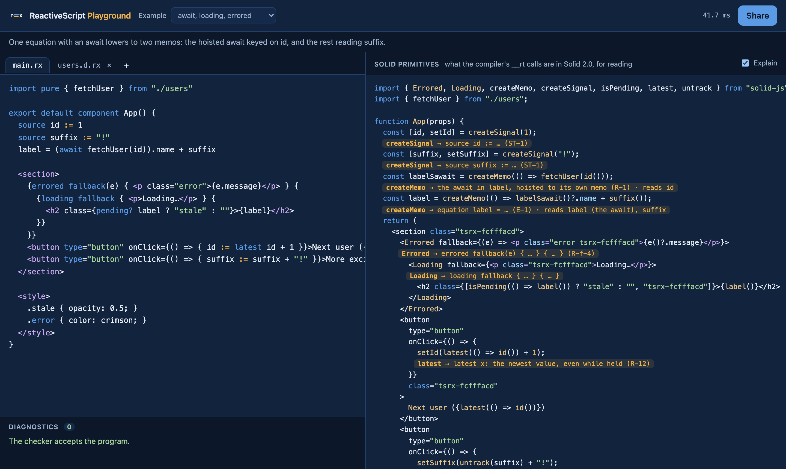

# ReactiveScript Playground



Type `.rx` on the left and see it as Solid 2.0 on the right: the program written with Solid's own primitives
(`createSignal`, `createMemo`, `createOptimistic`, `action`, `<Errored>`, `<Loading>`) and the checker's diagnostics
(each linked to `guide/diagnostics.md#<code>`). The program is kept in the URL hash, so a link reopens it.

The Solid view is the JSX the crate hands to Solid's compiler, with each `__rt` helper that is a Solid primitive
underneath written as that primitive and the mangled names (`v$id`, `w$id`) made plain (`src/solidify.ts`), then
formatted with Prettier. It is a reading aid, not the code that runs.

## How it compiles in the browser

`public/rxc.wasm` is the crate (`compiler/` in this repository) built for `wasm32-unknown-unknown`, the same build the
language server loads (`compiler/src/wasm.rs`: `rx_alloc`, `rx_call`, `rx_free`, and a host `env.rx_read`). The page
answers `rx_read` from the editor's files in memory, so there is no server and no filesystem. Each keystroke sends
`analyze` (diagnostics) for every `.rx` file and `app` with `jsx: true` for `main.rx`.

The `app` request is new: `app::app_with` takes a reader in place of the disk, `serve.rs` routes `app` to it, and with
`jsx: true` each module also carries the JSX printed before Solid's compiler runs (`emit::view_jsx`, over
`oxc_codegen`). `pnpm wasm` rebuilds `../../compiler` and copies the result into `public/` (it is not checked in).

The playground is not part of the deployed site: `site/.assetsignore` leaves `playground/` out of the static upload.
Publishing it would need a build step (`pnpm wasm && pnpm build`) and its `dist/` served under `/playground/`.

## Run

```sh
. ~/.local/share/solid-toolchain/env.sh
corepack pnpm@11.9.0 install
corepack pnpm@11.9.0 wasm     # needs Rust with the wasm32-unknown-unknown target
corepack pnpm@11.9.0 dev      # vite --host on port 3020
corepack pnpm@11.9.0 test     # Playwright against the running dev server
```
